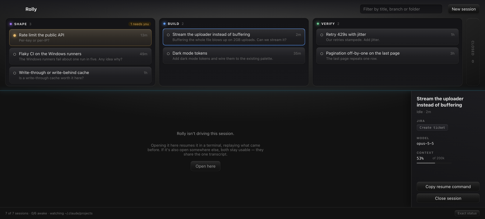

# rolly

A fleet view for Claude Code sessions. Every session across every repo on one
board, placed by how far the work has got and sorted by who needs you.



```bash
npm run dev          # electron-vite, hot reload
npm run build        # production bundle into out/
npm start            # build + launch
npm run type-check   # vue-tsc over main, preload and renderer
```

## The board

Three columns — Shape, Build, Verify — and every session sits in one of them.
Clicking a card opens that session in the terminal below; dragging it to another
column pins its stage, and dragging it to the rail on the right closes it.

Below the board is one terminal, and to its right a panel for whatever is
selected: state and age, its Jira ticket, its pull requests, the model it is on
and how much of the context window it has eaten.

Rolly keeps at most six sessions awake at once. Opening a seventh puts the
stalest one to sleep — never one that is mid-turn — and the card stays on the
board, because a sleeping session is still work you have not finished.

## How it reads sessions

Claude Code appends a JSONL transcript per session under
`~/.claude/projects/<cwd-slug>/<sessionId>.jsonl`. Those lines already carry
`cwd`, `gitBranch`, `customTitle` and timestamps, so the board needs no
instrumentation — `SessionWatcher` tails the tree and folds each line into a
record.

Transcripts reach tens of megabytes, so the indexer **indexes once and tails
forever**: a cold file is streamed a single time, then only bytes appended past
the stored offset are re-read. A half-written trailing line is never consumed,
so the cursor only ever advances past complete lines.

## Driving a session

`New session` takes a name and a folder — the folder list is every cwd rolly has
seen a session in — and spawns `claude` in an app-owned pty
(`pty/manager.ts`), rendered by xterm.js. Three things make that work:

- **The name is forced** with `--name`, so a row reads as something meaningful
  from the first frame instead of waiting for Claude to generate `ai-title`.
- **The session id is chosen up front** and passed as `--session-id`, so the pty
  and the transcript the watcher later finds are the same session. No heuristic
  correlation between what rolly spawned and what shows up on the board.
- **The environment is sanitized.** A rolly launched from inside a Claude Code
  session inherits `CLAUDE_CODE_CHILD_SESSION`, which silently disables
  transcript saving in every child — the board would go blind for exactly the
  sessions it started. `pty/env.ts` strips it.
- **The pty runs under a login shell**, because a GUI-launched Electron has a
  PATH without `claude` in it.

Terminals are cached per session in the renderer, so switching rows keeps
scrollback; main keeps a capped buffer so a window reload can restore a pane.

## Sessions outlive rolly

Quitting rolly sends its children a SIGTERM rather than holding them open: the
transcript on disk is the durable thing, not the process. A session comes back
through **Open here**, which resumes it — `claude --resume` replays the prior
turns into the pane, so an adopted session opens in context and needs no
separate read-only renderer.

**Opening a session that is already live elsewhere is fine.** Two `claude`
processes resumed onto one session append to a single transcript with no
corruption — turns interleave in timestamp order, nothing is malformed, and each
process picks up the other's turns. So there is no ownership check and no "is
this busy?" guess: `Open here` is unconditional, and it reads as taking the
session over because that is what it does.

The one thing the pane does have to handle: **a folder rolly hasn't opened
before shows a trust prompt** as its first screen, answered in the terminal like
any other prompt.

Forking was built and then removed once that turned out to be unnecessary. If
it's ever wanted, `--fork-session --session-id <new>` does branch onto an id
rolly picks, so correlation survives a fork.

### Closing

`/exit` is text typed at a prompt, so it does nothing while Claude is mid-turn
or sitting on a permission prompt — which is most of the times you want out.
**Close** signals the process instead: SIGTERM so claude can flush, SIGKILL
three seconds later if it is wedged. The timer compares pty *identity*, not the
id, so a resume that claimed the same id in between can't be killed by a stale
timer.

Close also clears the row, because "close this session" means get it off the
list. Nothing is destroyed: closed rows collect in a **Closed** group and
**Reopen** restores them. Dismissal stores a *timestamp*, not a flag, so any
transcript activity newer than it un-hides the row — a session cannot go quietly
missing from the fleet while it is still working.

Two rolly instances can run at once, each with its own ptys, so one window's
"live" badge says nothing about the other's. The badge is driven by the exit
event and **reconciled against `pty.alive()` every 15s**; the event was once
observed dropping, leaving a row claiming live with no process behind it.


## Model, effort and context

Every turn records its `model`, `effort`, `permissionMode` and a `usage` block,
so the header shows what a session is actually running on without asking the
process anything.

Context fullness is `input + cache_read + cache_creation` for the latest turn.
Transcripts don't record the window size — and the model id carries no `[1m]`
marker — so the limit is **inferred from the session's own peak**: the smallest
tier (200k, 1M) the peak fits inside. A session that has been past 200k is
provably on the larger window. The panel shows a chip only once a session passes
70%, amber to 90% and red beyond.

## Status

`sessions/status.ts` guesses *working / needs-you / idle* from transcript shape
alone — recency, whose turn is last, and whether the reply trails off in a
question. It needs no setup and it is wrong often enough to notice: an
abandoned session whose last reply happened to ask something reads as "needs
you" forever.

**Hooks replace the guess.** Rolly listens on `127.0.0.1:7878`, with a random
per-launch token in the path, and Claude Code posts events to it. The handler
answers before it parses the body, because a hook blocks the session until the
request returns — the response measures about half a millisecond.

Working and idle are the least of it; the transcript already implies those.
What it can't record is a session **blocked on a permission dialog**, or one
killed by a `StopFailure` — a rate-limited session now says "Rate limited"
instead of sitting there looking idle. That reason shows in the row and the
header badge.

Hook truth only outranks the transcript **while it is newer than it**, so a
restart with an empty map falls back to inference by itself, and so does a
session that was running before the hooks were installed.

Enabling it is a copy-paste: the board footer opens a dialog with the config.
Writing it into `~/.claude/settings.json` from rolly was built and dropped —
the auto-mode classifier blocks code that rewrites Claude Code's own settings,
which is a fair call.

Two things to know before installing it globally. `SessionStart` was never
observed firing. And with rolly closed, Claude prints one warning per session
(`connect ECONNREFUSED`) — harmless, since a connection failure is a
non-blocking error and the run completes normally, but visible. A `command`
hook with `async: true` and `curl … 2>/dev/null || true` is the silent
alternative, at a subprocess per event.

## The lifecycle axis

The columns are **Shape / Build / Verify** — figuring it out, in flight, has a
PR open — derived from transcript shape alone (`sessions/stage.ts`). It is a
heuristic and a wrong call is correctable: dragging a card to another column
pins it there.

Needs-you is *not* a fourth group. Urgency cuts across the axis, so it shows as
an amber card and sorts to the top of its own column, with finished work sinking to
the bottom. The column header carries a `n needs you` badge, so a session
waiting on you is visible without reading every card.

## Rolly's own folder

App state is a `state.json` in Electron's `userData` — stage overrides,
collapsed groups, Jira keys, dismissals, window bounds — written through a 250ms
debounce.

Sessions started from rolly run in `userData/workspace`, **not** a repository,
so work spanning several repos has a neutral home and rolly never edits a repo
by accident. On first run that folder is seeded with a `CLAUDE.md` and a memory
dir, so sessions rolly creates share one memory instead of a per-repo one. The
memory path has to be derived the way Claude Code slugs a cwd: every separator
**and space** becomes a dash.

Note for anything writing state from the renderer: a Vue reactive proxy is not
structured-cloneable, so `ipcRenderer.invoke` rejects on one — silently, if the
call is `void`ed. Everything crossing IPC goes through `toRaw()`.

## Jira

A Jira key taken from the branch named the same ticket for every session sharing
a working tree, and was simply wrong for sessions doing something else. There is
no per-session key anywhere in a transcript to replace it with — so rolly stops
inferring and **owns** the mapping: it creates the ticket itself and records
`sessionId -> {key, url}` in its own state.

Credentials go through `safeStorage` (the OS keychain) into `jira.bin`, never
`state.json`, and are verified against `/rest/api/3/myself` before being saved.
Projects and their issue types are read live from `/project/search`. The draft
is composed from what rolly already knows — title as summary, your last prompt
plus PR URLs as description — and **every ticket goes through an editable
preview**, because creating one writes to the team's board.

Descriptions are converted to Atlassian Document Format; the v3 API takes
nothing else.

`claude -p` has **no** Atlassian MCP access — connectors are interactive-only —
which is what ruled out drafting tickets with a headless Claude.

## Pull requests

PR URLs are pulled out of the transcript by correlating `gh pr create` tool_use
ids with their results, and the discriminator is the URL **alone on its own
line** — matching the command too loosely picks up grep output, too strictly
misses compound commands.

State is polled with **one batched GraphQL call for every known PR every 30s**,
aliased per PR; a `gh pr view` each would be a subprocess apiece and burn the
rate limit far faster. Open is green, draft grey, merged purple, closed red and
struck through. It is never persisted — a restart re-polls rather than showing
yesterday's answer — and `gh` runs under a login shell for the same PATH reason
the pty does.

## Icon and packaging

The mark is generated, not hand-drawn: `scripts/icon-svg.mjs` draws four
logarithmic-spiral arms on a teal tile, and `npm run icon` renders it to
`assets/` as SVG, a 1024px PNG, an `.iconset` and an `.icns`.

The renderer captures **once** at 1024 in an off-screen Electron window and
downscales with `nativeImage.resize` — a window per size races on `loadURL` and
fails after the first capture. It also has to be bundled to CJS first, because
Electron won't take a bare `.mjs` as its entry point.

```bash
npm run icon       # regenerate every icon asset
npm run package    # unpacked Rolly.app into release/
npm run dist       # a dmg
```

**The app is only called "Rolly" when packaged.** macOS reads the menu-bar name
from the bundle's `CFBundleName`, so an `electron .` dev run says "Electron" no
matter what `app.setName` does. Everything that *can* be set at runtime — about
panel, dock icon, window title, userData path — is.

## Testing

`scripts/pty-smoke.ts` drives the real manager inside Electron — spawns a
session, types a prompt, and waits for the transcript to appear at the id it
chose:

```bash
npx esbuild scripts/pty-smoke.ts --bundle --platform=node --format=cjs \
  --external:electron --external:node-pty --alias:@shared=./src/shared \
  --outfile=scripts/pty-smoke.cjs
./node_modules/.bin/electron scripts/pty-smoke.cjs <a-trusted-folder>
```

`ROLLY_FOLDER=<path>` makes the New-session folder picker return that path
instead of opening a native dialog, which is what lets the UI be driven from a
harness. Other probes follow the same bundle-then-run shape:
`stage-probe` and `summary-probe` replay the classifier over real transcripts,
`pr-probe` runs the PR poller headlessly, `two-writers` is the experiment behind
the unconditional **Open here**.

### Driving the UI

There is no way to tell whether a desktop UI actually renders without looking at
it, and `screencapture` is black without screen-recording permission. Launch
with a debugging port and go through the Chrome DevTools Protocol:

```bash
open release/mac-arm64/Rolly.app --args --remote-debugging-port=9444
curl -s http://localhost:9444/json          # find the page target
```

Connect to `webSocketDebuggerUrl` with Node's built-in `WebSocket` — no `ws`
dependency — and use `Page.captureScreenshot`, `Runtime.evaluate` to query and
click, `Input.insertText` to type into a pane for real. Setting a Vue `v-model`
input needs the native setter plus a dispatched `input` event. This caught a
mangled file path and a wrapping metadata row that type-check and build both
passed.

**Don't repackage or quit while a session is live** — quitting SIGTERMs rolly's
children and kills work mid-turn. Check for `claude` under the app's pid first.
Delete any test transcripts afterwards; they show up as rows like anything else.

## Roadmap

- **M1 — the rail is real.** ✅ watcher, indexer, session list.
- **M2 — the terminal.** ✅ xterm.js over an app-owned pty; "New session".
- **M3 — adopt.** ✅ "Open here" resumes any session into a pane, whether or not
  something else has it open.
- **M4 — hooks.** ✅ localhost endpoint; exact status, including the states no
  transcript records.
- **M5 — Windows.** Packaging, and `sessions/paths.ts` is the only file that
  should need to care.

Shipped alongside: the Shape/Build/Verify axis, Jira ticket ownership, PR state
polling, and closing that works.

Deliberately not built yet: a git diff pane (the split wasn't convincing — the
diff is folders across several repos, not file-by-file, and VSCode already does
it well), a review queue over open PRs, and a scheduled briefing agent.
